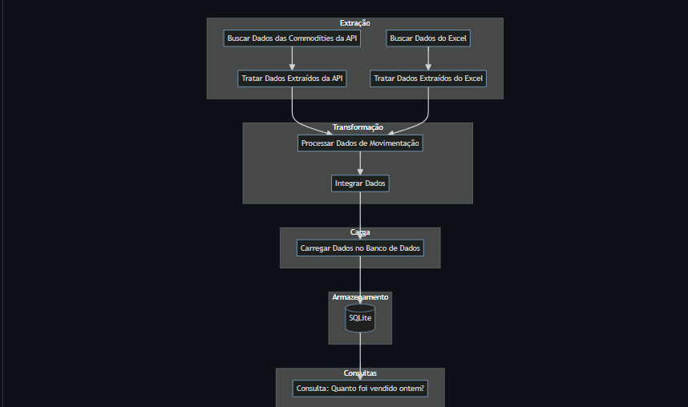

# ETL | Cotações e movimentações de commodities

Pipeline que integra preços de commodities com movimentações e carrega os dados em SQLite.

**Dados e integrações de apoio** · Pipeline ETL

[← Data Science, IA e Automações · Thiago Oliveira](https://github.com/thiagoramos20042/thiagoramos20042) · [Catálogo de projetos](https://github.com/thiagoramos20042/thiagoramos20042/blob/main/PROJETOS.md)

## Objetivo

Conectar cotações de petróleo, ouro e prata às operações de uma base de movimentação para análise.

## O que você encontra

- Extração de cotações com yfinance.
- Padronização de datas e integração com movimentações.
- Cálculo de valor/ganho por operação e carga na tabela commodities.

## Tecnologias

Python · pandas · yfinance · Loguru · SQLite

## Arquivos principais

| Arquivo | Conteúdo |
| --- | --- |
| [extract.py](extract.py) | Busca de cotações e registro de logs. |
| [transforme.py](transforme.py) | Tratamento e integração dos dados. |
| [load.py](load.py) | Orquestração e carga no banco local. |
| [imagem.png](imagem.png) | Diagrama do projeto. |

## Como explorar

Prepare data/movimentacao_commodities.csv com as colunas date, symbol, quantity e action, e crie a pasta data/dw. Esse CSV de entrada não está versionado. Depois, na raiz:

```bash
python -m pip install pandas yfinance loguru
python load.py
```

load.py chama as funções de extração e transformação e grava data/dw/commodities_dw.db.

## Visualização



## Contexto do projeto

A integração usa data e símbolo da commodity como chaves. O código atribui valor positivo a operações sell e negativo às demais ações.

---

Integra o [portfólio de Thiago Oliveira](https://github.com/thiagoramos20042).
